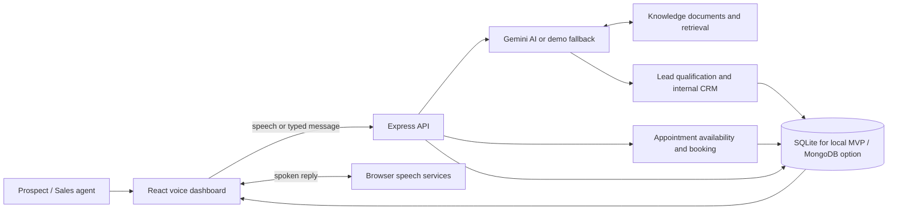

# VoxPilot AI — Autonomous Sales Voice Agent

VoxPilot is an individual MVP for helping a sales team handle an inbound property enquiry: talk with a prospect, answer from company documents, qualify the lead, book a consultation, and save a call summary.

## How it works



In a demo, start a call, share a property requirement, ask a question from the sample knowledge base, then request a consultation time. The app saves the conversation, scores the lead, checks the appointment slot, and shows the result in the dashboard. Ending the call creates a summary and next action.

More detail, a workflow walkthrough, security notes, and a scale-up plan are in [docs/ARCHITECTURE.md](docs/ARCHITECTURE.md). A concise project overview for presentation is in [docs/PROJECT_REPORT.md](docs/PROJECT_REPORT.md).

## What is implemented?

| Requirement | MVP status |
|---|---|
| Real-time voice interaction | Browser microphone/speech recognition where supported; browser text-to-speech. Text chat is also available. This is not a phone/PSTN dialer. |
| Contextual memory | Transcript and extracted details are kept for the active call and saved with the call. No cross-call personal memory. |
| Multilingual communication | English and Hindi are configured. Speech recognition and voices depend on the browser/device. |
| Lead qualification and sentiment | Implemented with structured extraction and a deterministic 0–100 scoring rubric; AI responses use Gemini when configured. |
| Knowledge retrieval | Implemented: uploaded/sample documents are chunked and ranked with keyword/IDF matching. It is not embedding/vector-database retrieval. |
| Appointment booking | Implemented: checks existing bookings and reports conflicting time slots. |
| CRM integration | Implemented as the app's own lead records and dashboard. No external CRM vendor integration is included. |
| Call summary and insights | Implemented: call summary/next action and dashboard metrics, with a deterministic summary fallback. |
| Functional MVP / end-to-end workflow | The UI and API support the workflow described above. Sample data is synthetic; verify live AI and browser speech in your demo environment. |
| Architecture diagram and project report | Included in `docs/`. |
| 100,000-user scale, production deployment/costs | Future design and estimates depend on usage; this MVP has not been load-tested for 100,000 users. See `docs/ARCHITECTURE.md`. |

## Run locally

Requires Node.js with built-in `node:sqlite` support (Node.js 22 or newer recommended).

1. Copy `.env.example` to `.env`. Add a Gemini API key only if you want Gemini responses and server-side audio transcription; the text demo fallback works without it.
2. Install dependencies: `npm run install:all`
3. Start the API and frontend: `npm run dev`
4. Open `http://localhost:5173` and sign in with the seeded demo account: `demo@voxpilot.ai` / `VoxPilot@2026`.

The demo credentials are for local evaluation only. Change or disable seeded credentials and set a unique `JWT_SECRET` before any public deployment. Never commit `.env` or put server secrets in `VITE_*` variables.

Useful checks:

```bash
npm run build
npm run test:api
```

Deployment guidance for hosting the frontend and API separately is in [DEPLOYMENT.md](DEPLOYMENT.md).

## Interview-day checklist

- Laptop with the project installed and ready to run.
- GitHub repository/source code: [VoxPilot AI](https://github.com/SaiVaishnavKumar/VoxPilot-AI-Autonomous-AI-Sales-Voice-Agent).
- System architecture diagram: [docs/ARCHITECTURE.md](docs/ARCHITECTURE.md).
- Updated printed resume.
- College ID card.

Bring your resume and ID yourself; do not upload personal identity documents to this public repository.
