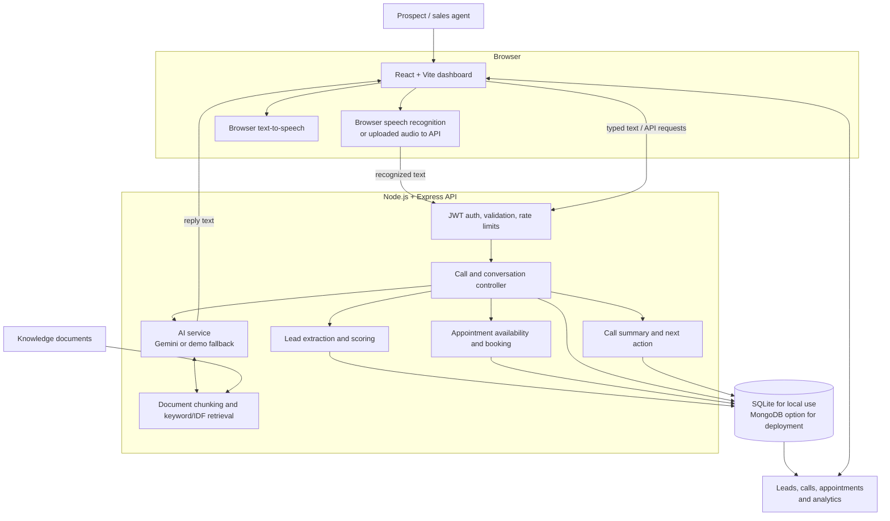

# VoxPilot AI — Architecture and evaluation checklist

## Simple system view

## Explain it in under a minute

“VoxPilot is a web-based sales assistant. A prospect speaks or types in the dashboard. The browser handles speech input and playback; the Express API keeps the conversation and passes the latest message, call history, and relevant company facts to the AI. The app extracts buying needs, scores the lead, saves it in its own CRM, and books a consultation only after checking the slot. When the call ends, it stores a summary and next step. For local demos it can use SQLite and a rule-based AI fallback; Gemini and MongoDB are optional integrations.”

## End-to-end demo workflow

1. Sign in and open **Voice Agent**. Start a call in English or Hindi.
2. Use a microphone in a supported browser or type: “I want a 3BHK in Gachibowli, budget 95 lakhs, and I plan to buy in two months.”
3. Ask a question answered by the sample company knowledge documents, such as the Skyview price range.
4. Share a name/phone and request a consultation for an available date and time. Show the booked appointment; try an occupied slot to show the conflict response.
5. End the call. Show the saved transcript, lead score, sentiment, summary, recommended next action, appointment, and analytics pages.

Use synthetic/sample data in a public demo. Browser speech support, API key availability, and seeded database state can affect what works live.

## What is present today?

| Evaluation item | Evidence / honest scope |
|---|---|
| Working prototype | React dashboard and authenticated Express API provide calls, leads, appointments, knowledge documents, and analytics. |
| Voice / STT / TTS | Browser speech recognition when available; uploaded audio can be transcribed through Gemini. Replies are spoken with browser TTS. No telephony/PSTN integration. |
| Memory and language | Active-call transcript and extracted fields are passed to AI and persisted. English and Hindi are configured; no persistent cross-call memory. |
| Qualification / sentiment | Lead fields and sentiment are extracted; a deterministic weighted 0–100 rubric produces qualification status. |
| RAG | Document ingestion and chunking, then lexical keyword/IDF ranking to select facts for the AI prompt. No embeddings or vector database. |
| Booking / CRM | Conflict-checked appointment booking and an internal lead CRM. No calendar-provider sync or external CRM connector. |
| Summaries / insights | Call summary and recommended action, plus dashboard/analytics aggregates. Gemini summaries have a deterministic fallback. |
| Diagram / report | This architecture document and [one-page project report](PROJECT_REPORT.md) are included. |
| 100,000 users | Not achieved or load-tested by this MVP. The following is a scale-up design, not a performance claim. |

## Security and operations

The API uses password hashing, JWT authentication, Helmet, CORS configuration, and request rate limits. Keep API keys and production secrets on the server, use HTTPS, rotate secrets, restrict CORS to the real frontend, and change the seeded demo password before deployment. The MVP stores contact details and transcripts; before real customer use, define consent, retention/deletion, access controls, backups, and appropriate encryption at rest/in transit. Do not send sensitive real customer data to an AI provider without reviewing its data terms and obtaining required consent.

For deployment, host the static frontend on Netlify (or equivalent) and the Express API on a persistent Node.js service. Use MongoDB Atlas or another managed durable database in production; SQLite is intended for local evaluation and is not suitable for ephemeral serverless storage. Follow [DEPLOYMENT.md](../DEPLOYMENT.md) for environment variables and deployment setup. Add centralized logs, health checks, alerts, backups, and an incident/restore runbook before production.

## Scale-up strategy toward 100,000 registered users

“100,000 users” must be defined by peak concurrent users and calls per minute; registered users alone do not size voice or AI infrastructure. A future design could:

1. Keep the web/API tier stateless and horizontally scale multiple API instances behind a load balancer; use managed authentication/session controls, request quotas, and per-tenant isolation.
2. Move AI/transcription and call-end processing to a durable queue with bounded concurrency, retries, timeouts, and dead-letter handling. Stream or chunk audio only if a real-time telephony product is added.
3. Use a managed database with indexes and measured connection pooling; partition high-volume call/transcript data by tenant/time. Store uploaded files in object storage rather than application memory/disk.
4. Add a managed cache for short-lived availability/session data and a production search/vector service only if measured retrieval quality/volume justifies it.
5. Load-test realistic call lengths, model latency, peak concurrency, database writes, and failure recovery. Set service-level objectives and autoscaling thresholds from those results; do not claim 100,000 concurrent calls without separate capacity tests.

## Deployment and operating-cost discussion

There is no defensible single monthly price without expected calls, average audio minutes, model/token usage, regions, retention, and availability targets. For a presentation, calculate:

`monthly cost = web hosting + API compute + database/storage/backups + AI tokens + transcription/audio minutes + monitoring/network + support`

The local MVP can run with SQLite and the deterministic text fallback, so paid AI usage is optional. A production estimate should use a stated monthly volume and current provider quotes; AI and audio usage will usually vary directly with conversation volume. Compare cost per qualified lead and booked appointment with the value of recovered sales time and conversion lift. Recalculate after a small pilot, then scale only after measured latency, reliability, and unit economics meet targets.
